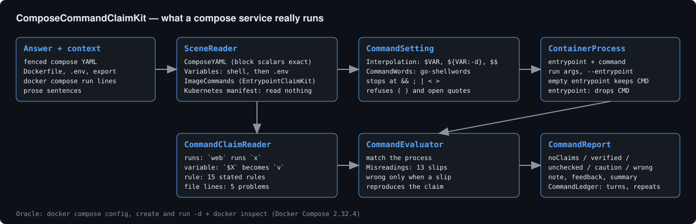
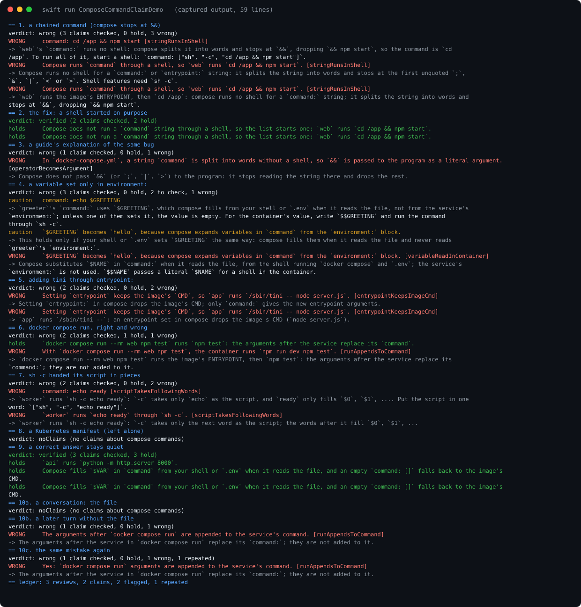
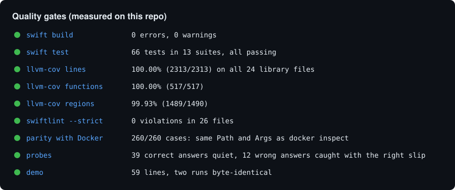

# ComposeCommandClaimKit

Checks what an answer says a Docker Compose service runs, against what compose really starts.



## The problem

Ask a model why `command: cd /app && npm start` never starts the app, and you often get a confident, wrong
explanation. "Compose runs `command` through a shell." It does not. "The `&&` is passed to `cd` as a literal
argument." It is not either: compose stops reading the string at `&&` and drops the rest, so the container runs
`cd /app` and nothing else. The file passes `docker compose config`. The mistake shows up only when the container
starts, or does not.

The same goes for the rest of how compose starts a container:

- `$GREETING` in `command:` is filled in when compose reads the file, from your shell or `.env`. The service's own
  `environment:` is never used for it.
- Setting `entrypoint:` drops the image's `CMD`. Setting it to `""` clears the image's `ENTRYPOINT` and keeps the
  `CMD`.
- `docker compose run web npm test` replaces the service's `command:`. It does not add to it. `--entrypoint` drops
  the service's `command:`, and unlike `docker run` it is split into words.

ComposeCommandClaimKit reads the compose file, the Dockerfile and the `.env` an answer shows, works out the exact
process each service starts, and checks the answer's sentences and the file's own lines against it.

## What it checks

**Stated results.** "`web` runs `npm run dev`", "`docker compose run web npm test` runs `npm test`", "`$GREETING`
becomes `hi`". A stated command line that differs from what compose starts is called wrong only when a known
misreading reproduces it exactly; otherwise it is left unchecked. Ten of the slips below can reproduce a stated
line; the other three come from stated rules.

| Slip | The misreading |
|---|---|
| `stringRunsInShell` | a `command:` string runs through `/bin/sh -c` |
| `operatorBecomesArgument` | `&&`, `;`, `\|` or `>` reach the program as arguments |
| `variableReadInContainer` | `$VAR` comes from the container or `environment:` |
| `dollarDollarExpanded` | `$$VAR` is expanded although no shell runs the command |
| `listItemSplit` | a list item with spaces is several words |
| `entrypointKeepsImageCmd` | a compose `entrypoint:` keeps the image's `CMD` |
| `emptyEntrypointDropsCmd` | an empty `entrypoint:` drops the image's `CMD` |
| `commandReplacesEntrypoint` | `command:` replaces the image's `ENTRYPOINT` |
| `emptyCommandClears` | `command: []` runs nothing |
| `runAppendsToCommand` | `docker compose run` arguments are added to `command:` |
| `runEntrypointKeepsCommand` | `run --entrypoint` keeps `command:` |
| `scriptTakesFollowingWords` | `sh -c` takes every following word as its script |
| `shellEntrypointTakesCommand` | a shell-form `ENTRYPOINT` receives the command |

**Rules.** 15 rules answers state, true or false ("Compose runs `command` through a shell", "Setting `entrypoint`
drops the image's `CMD`"), negations included.

**File lines.** The `command:` and `entrypoint:` lines of the compose files the answer shows:

- a string cut at `&&`, `;`, `|`, `<` or `>`;
- a string `docker compose` refuses ("invalid command line string");
- a `$VAR` that the service sets only in `environment:`;
- `sh -c` handed its script in pieces;
- a list item that is a whole command line.

**Left alone.** An answer with a Kubernetes manifest (there `command:` replaces the image's `ENTRYPOINT`). Sentences
about Dockerfiles, healthchecks and `docker run`. Instructions, questions and hypotheticals ("you might expect...").

## What compose really does

Every rule here was probed against `docker compose config`, `docker compose create`, `docker compose run -d` and
`docker inspect` (Docker Compose 2.32.4). Some of what the probes found is not in the docs:

- At an unquoted `;`, `&`, `|`, `<` or `>`, compose's word splitter (go-shellwords) stops and drops the rest
  **without reading it**: `echo a && echo "b` loads fine. A word starting with a digit right before `>` goes with
  it: `echo a 2>&1` is `echo a`.
- An unquoted `(` or `)`, an unclosed quote and a trailing backslash make `docker compose` refuse the file. `$(a b)`
  stays one literal word, spaces and all.
- `#` is not a comment inside a quoted `command:` string, and `~`, `*` and `$(...)` stay literal.
- Variables are substituted before the string is split: `echo ${A:-hello world}` is three words, and a value with
  `;` in it cuts the command too.
- `entrypoint: ""` and `[]` clear the image's `ENTRYPOINT` but keep its `CMD`. `command: []` and `""` fall back to
  the image's `CMD`. An image with neither, and no `command:`, gets "no command specified".
- `docker compose run --entrypoint "/bin/sh -c"` is `/bin/sh` `-c` (split), and `--entrypoint` drops the service's
  `command:`.

`Scripts/parity.py` rebuilds `Tests/ComposeCommandClaimKitTests/ParityFixture.swift` from 260 cases run through
Docker. Each case is one service, an image built `FROM scratch`, an optional `.env`, shell variables and an optional
`docker compose run` line. The kit gives the same Path and Args as `docker inspect` for all 260.

## Install

```swift
.package(url: "https://github.com/rajatslakhina/compose-command-claim-kit.git", from: "1.0.0")
```

```swift
.product(name: "ComposeCommandClaimKit", package: "compose-command-claim-kit")
```

It depends on [EntrypointClaimKit](https://github.com/rajatslakhina/entrypoint-claim-kit) and
[DockerfileClaimKit](https://github.com/rajatslakhina/dockerfile-claim-kit) to read a Dockerfile's `ENTRYPOINT`
and `CMD`. Swift 6, macOS 13, iOS 16, tvOS 16, watchOS 9.

## Use

~~~swift
import ComposeCommandClaimKit

let answer = """
```yaml
services:
  web:
    build: .
    command: cd /app && npm start
```

Compose runs `command` through a shell, so `web` runs `cd /app && npm start`.
"""

let report = CommandClaimChecker().check(answer, context: question)
report.verdict        // .wrong
report.summary        // "3 claims checked, 0 hold, 3 wrong"
report.note           // "Compose command check: ..." for the person reading the answer
report.feedback       // a message asking the model to correct exactly these points
~~~

Across a conversation, `CommandLedger` keeps the compose file, Dockerfile and `.env` an earlier answer showed, and
marks a mistake stated again after it was flagged:

```swift
let ledger = CommandLedger()
let first = await ledger.review(answerWithTheFile)
let later = await ledger.review(followUp, context: question)
later.repeatedCount
```

To work with the pieces: `CommandClaimChecker.scene(for:context:)` gives what the conversation shows,
`claims(in:context:)` the claims, and `judge(_:in:)` one finding. `ComposeProject.read(_:variables:)` reads a compose
file on its own.

## Demo

`swift run ComposeCommandClaimDemo` checks ten answers. Real output:



## Quality



| Gate | Result |
|---|---|
| `swift build` | 0 errors, 0 warnings |
| `swift test --enable-code-coverage` | 67 tests in 14 suites (Swift Testing), all passing |
| `llvm-cov report` | 100.00% lines (2332/2332) and functions (520/520) on all 24 library files; regions 99.93% (1498/1499) |
| `swiftlint lint --strict` | 0 violations in 26 files (SwiftLint, run for real) |
| Parity | 260/260 cases match `docker inspect` |
| Probes | 50 correct answers never flagged; 12 wrong answers caught with the right slip |

Coverage is measured with `--no-parallel` and filtered to `Sources/ComposeCommandClaimKit`.

## Limits

- One compose file at a time. An answer with several (base plus override, or a before and after) leaves its stated
  results unchecked: merging is [ComposeMergeClaimKit](https://github.com/rajatslakhina/compose-merge-claim-kit)'s
  job. File lines are checked on the answer's last compose file, and not on a file the question already showed, so
  an answer that quotes your broken file is not flagged for it.
- A paragraph about Kubernetes (or a manifest anywhere in the conversation) states no compose rules.
- Two denials in one clause ("doesn't run it in a shell and doesn't expand `~`") are not read as a rule.
- A variable the conversation never sets comes from a shell nobody showed, so a command that uses one is unchecked
  (or holds only with a caveat, when the stated value is the one `environment:` sets).
- An image the conversation does not show has an unknown `ENTRYPOINT`: a claim that names the command holds, and a
  claim that needs the entrypoint is unchecked.
- Backtick shapes beyond spaces, operators and quotes were not probed and are left unfollowed.
- Claims are read from a fixed set of phrases. A sentence worded another way is not checked, never guessed at.

## License

MIT. See [LICENSE](LICENSE).
